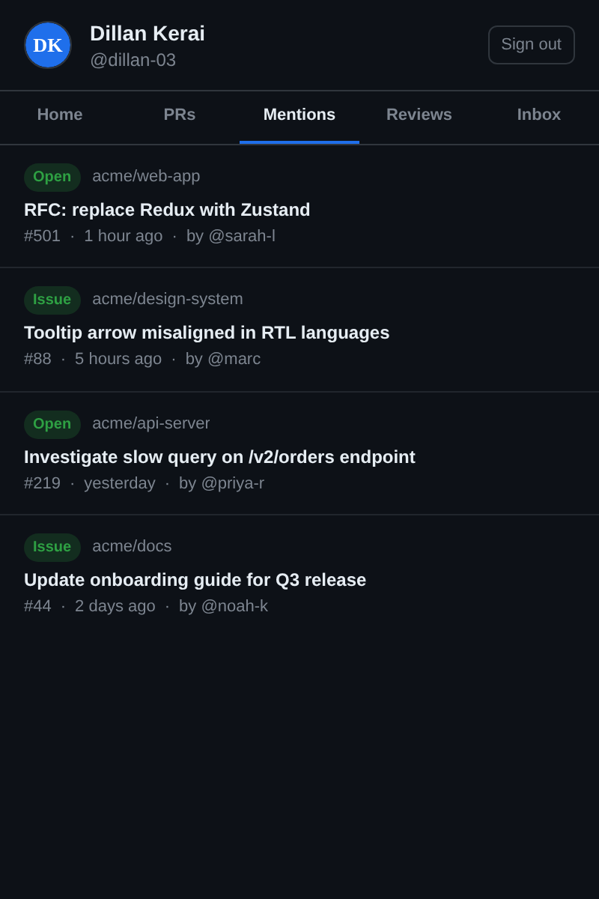

# github-chrome

A lightweight Chrome extension that gives developers an at-a-glance view of
their GitHub workflow — assigned PRs, mentions, reviews, and notifications —
without leaving their current browser context.

The popup is 400×600, dark-themed using GitHub's Primer color tokens, and
keeps everything one click away from the address bar.

> The screenshots below are mockups rendered with the extension's real
> Tailwind/Primer styling. Drop in screenshots from your own install to
> replace them.

## Screens

### Sign in


The first time you open the popup you're asked to authenticate. Two paths:

- **Personal Access Token** (default). Paste a token with `read:user`,
  `notifications`, and `repo` scopes. Tokens are encrypted with AES-GCM
  before being written to `chrome.storage`.
- **GitHub OAuth** (optional). Appears as the blue "Sign in with GitHub"
  button when both `VITE_GITHUB_OAUTH_CLIENT_ID` and
  `VITE_GITHUB_OAUTH_EXCHANGE_URL` are set at build time. See
  [Authentication](#authentication) for details.

### Home (dashboard)


The home tab summarises every other tab into a single row of counts. Click
any row to jump straight to that view. Counts come from a single batched
GitHub Search + Notifications API call so the dashboard is one round-trip,
not four.

### Assigned PRs


Open pull requests where you're the assignee, newest first. Each row shows
the PR's status (Open / Draft / Changes requested), repository, title, PR
number, and how long ago it was updated. Click a row to open the PR in a
new tab.

### Reviews


PRs where you're a requested reviewer. Author avatars are shown beside
each row, and PRs labeled as `blocking`, `urgent`, `priority`, `p0`, `p1`,
or `hotfix` get a coloured priority pill on the right so urgent reviews
don't get lost in the list.

### Mentions



Open issues and PRs where you've been `@`-mentioned, regardless of whether
you're the assignee. The author of the mentioning thread is shown in the
subtitle so you know who to reply to.

### Inbox (notifications)


Your unread GitHub notifications, grouped by repository with sticky
section headers. Filter chips along the top let you narrow to a single
reason (Assigned / Mentions / Reviews / Team). Each row has a glyph for
the subject type (PR, issue, discussion, CI check) and a one-click
"mark as read" button on the right.

## Tech stack

- Vite + React 18 + TypeScript
- Tailwind CSS v3 with GitHub Primer color tokens
- Chrome Manifest V3 (service worker background, popup UI)

## Project layout

```
github-chrome/
├── public/
│   ├── manifest.json              # Manifest V3
│   └── icons/                     # 16 / 48 / 128 px extension icons
├── src/
│   ├── background/
│   │   └── service-worker.ts      # MV3 background entry (stub for now)
│   ├── lib/                       # Framework-agnostic helpers
│   │   ├── auth.ts                # PAT + OAuth sign-in, encrypted storage
│   │   ├── crypto.ts              # AES-GCM wrapper for token at rest
│   │   ├── github-api.ts          # Typed GitHub REST client
│   │   └── relativeTime.ts        # "2 hours ago" formatter
│   ├── popup/
│   │   ├── App.tsx                # Top-level routing between tabs
│   │   ├── main.tsx               # React entry
│   │   ├── index.html             # Popup HTML shell
│   │   ├── tabs.ts                # TabId union
│   │   ├── components/            # UI components
│   │   │   ├── Badge.tsx          # Reusable status pill
│   │   │   ├── QueryView.tsx      # Loading / error / empty wrapper
│   │   │   ├── SubjectIcon.tsx    # Notification subject glyph
│   │   │   ├── States.tsx         # Spinner / EmptyState / ErrorState
│   │   │   └── …                  # Tab views, header, sign-in, etc.
│   │   ├── hooks/
│   │   │   ├── useAuth.ts         # Auth state + sign-in / sign-out
│   │   │   └── useGitHubQuery.ts  # Tiny data-fetching hook
│   │   └── lib/
│   │       └── cn.ts              # className joiner
│   └── styles/
│       └── globals.css            # Tailwind directives + reset
├── docs/
│   └── screenshots/               # README assets
├── scripts/
│   └── delete-closed-pr-branches.sh
├── tailwind.config.js
├── vite.config.ts
└── package.json
```

The `lib/` split keeps anything that talks to GitHub or the browser's
storage/crypto APIs reusable from both the popup and the background
worker. The popup only depends on `lib/`, never the other way around.

## Local development

```bash
npm install
npm run dev          # watch build → dist/
npm run build        # one-shot production build
npm run typecheck    # tsc --noEmit
```

### Load the unpacked extension in Chrome

1. Run `npm run build` (or `npm run dev` for watch mode).
2. Open `chrome://extensions` in Chrome.
3. Enable **Developer mode** (top-right toggle).
4. Click **Load unpacked** and select the `dist/` folder.
5. Pin the "GitHub Workflow Assistant" extension from the toolbar puzzle menu.

Re-run `npm run build` (or keep `npm run dev` running) after changes, then
hit the refresh icon on the extension card in `chrome://extensions`.

### Authentication

The popup supports two sign-in paths:

1. **Personal Access Token (default).** Create a token at
   [github.com/settings/tokens/new](https://github.com/settings/tokens/new) with
   scopes `read:user`, `notifications`, and `repo`, then paste it into the
   popup's sign-in screen. Tokens are encrypted with AES-GCM (key stored in
   `chrome.storage.local`) before being written to `chrome.storage.sync`.

2. **GitHub OAuth (optional).** Register an OAuth app and set the redirect URI
   to the value returned by `chrome.identity.getRedirectURL('oauth2')`. GitHub's
   OAuth flow requires a server-side token exchange (the client secret cannot
   ship in an extension), so you also need a small endpoint that accepts
   `{ code, state, redirect_uri }` and returns `{ access_token }`. Provide both
   values at build time:

   ```bash
   VITE_GITHUB_OAUTH_CLIENT_ID=Iv1.xxxxxxxxxxxxxxxx \
   VITE_GITHUB_OAUTH_EXCHANGE_URL=https://your.exchange/api/github \
   npm run build
   ```

   When either env var is missing the OAuth button is hidden and the popup
   falls back to PAT-only sign-in.

## Roadmap

Tracked as GitHub issues in this repo, labeled `[Feature]`. Phase 1 (MVP)
covers scaffold, auth, dashboard, assigned PRs, mentions, reviews, and the
notifications inbox. Future tickets will wire up the background worker for
badge counts and desktop notifications.
