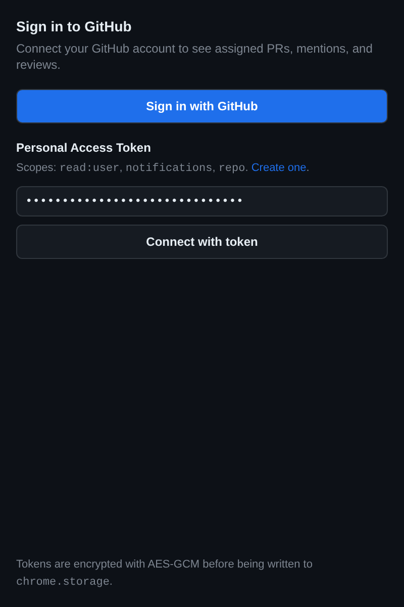
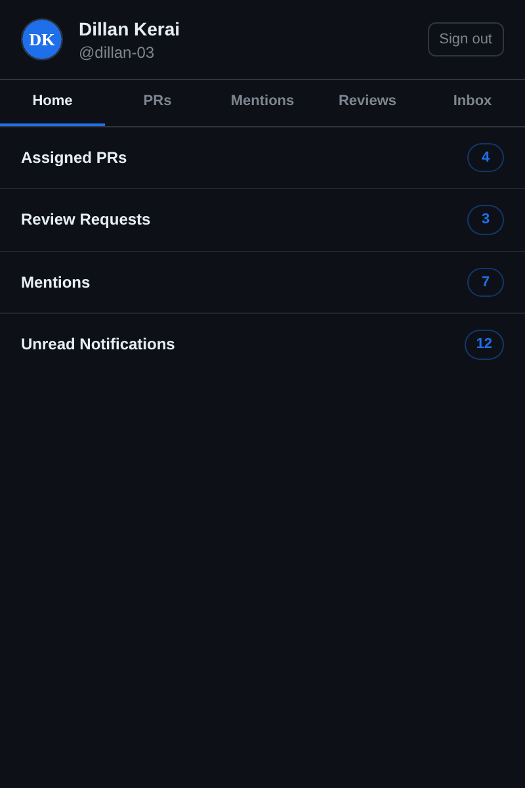
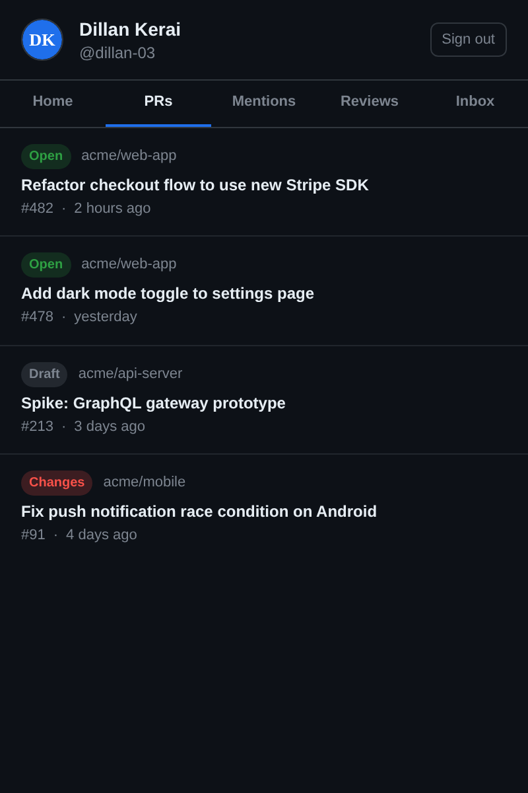
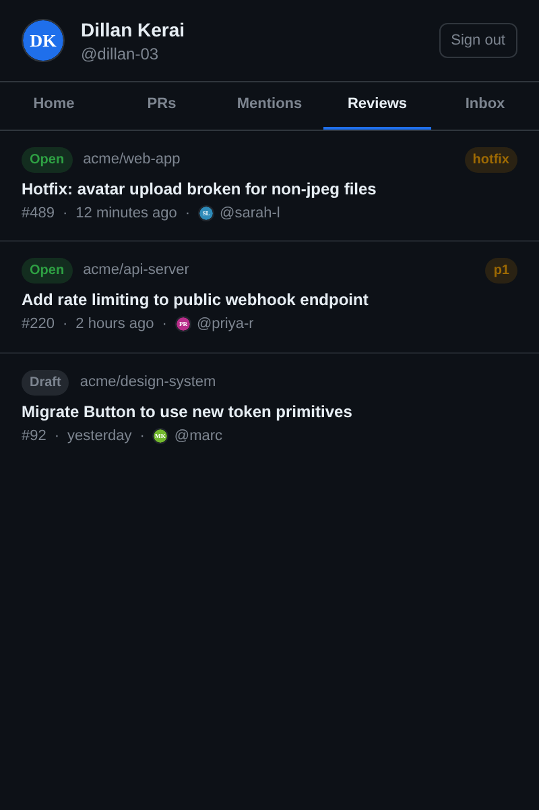
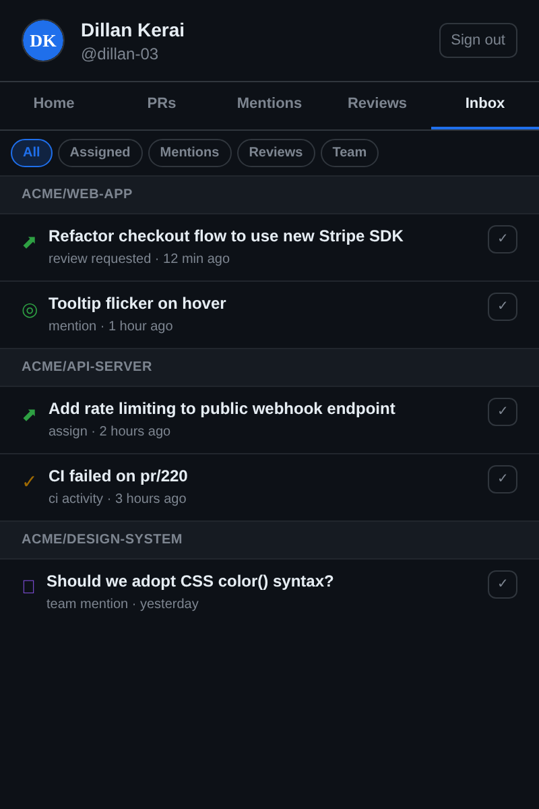

# github-chrome

A lightweight Chrome extension that gives developers an at-a-glance view of
their GitHub workflow — assigned PRs, mentions, reviews, and notifications —
without leaving their current browser context.

The popup is 400×600, dark-themed using GitHub's Primer color tokens, and
keeps everything one click away from the address bar.

> The screenshots below are mockups rendered with the extension's real
> Tailwind/Primer styling. Drop in screenshots from your own install to
> replace them.

## Screens

### Sign in



The first time you open the popup you're asked to authenticate. Two paths:

- **Personal Access Token** (default). Paste a token with `read:user`,
  `notifications`, and `repo` scopes. Tokens are encrypted with AES-GCM
  before being written to `chrome.storage`.
- **GitHub OAuth** (optional). Appears as the blue "Sign in with GitHub"
  button when both `VITE_GITHUB_OAUTH_CLIENT_ID` and
  `VITE_GITHUB_OAUTH_EXCHANGE_URL` are set at build time. See
  [Optional: enable GitHub OAuth sign-in](#optional-enable-github-oauth-sign-in)
  for details.

### Home (dashboard)



The home tab summarises every other tab into a single row of counts. Click
any row to jump straight to that view. Counts come from a single batched
GitHub Search + Notifications API call so the dashboard is one round-trip,
not four.

### Assigned PRs



Open pull requests where you're the assignee, newest first. Each row shows
the PR's status (Open / Draft / Changes requested), repository, title, PR
number, and how long ago it was updated. Click a row to open the PR in a
new tab.

### Reviews



PRs where you're a requested reviewer. Author avatars are shown beside
each row, and PRs labeled as `blocking`, `urgent`, `priority`, `p0`, `p1`,
or `hotfix` get a coloured priority pill on the right so urgent reviews
don't get lost in the list.

### Mentions


Open issues and PRs where you've been `@`-mentioned, regardless of whether
you're the assignee. The author of the mentioning thread is shown in the
subtitle so you know who to reply to.

### Inbox (notifications)



Your unread GitHub notifications, grouped by repository with sticky
section headers. Filter chips along the top let you narrow to a single
reason (Assigned / Mentions / Reviews / Team). Each row has a glyph for
the subject type (PR, issue, discussion, CI check) and a one-click
"mark as read" button on the right.

## Getting started

End-to-end: clone the repo, build the extension, load it into Chrome,
and sign in with a token. About 5 minutes.

### Prerequisites

- **Node.js 18+** and **npm 9+** (`node --version` to check). Vite 5
  needs Node 18 at minimum; 20 LTS is recommended.
- **Google Chrome** (or any Chromium-based browser that supports
  Manifest V3 — Edge, Brave, Arc all work).
- **A GitHub account** and the ability to create a Personal Access
  Token (no admin rights needed).

### 1. Install dependencies

```bash
git clone https://github.com/Dillan-03/github-chrome.git
cd github-chrome
npm install
```

### 2. Build the extension

Pick one:

```bash
npm run build        # one-shot production build → dist/
npm run dev          # rebuilds dist/ on every file save (watch mode)
```

Use `npm run dev` while you're hacking on the code; use `npm run build`
for a clean install. Both produce a `dist/` folder that Chrome can load
as an unpacked extension.

> The popup is a *bundled* React app, not a live dev server. There is
> no `localhost:5173` — Chrome loads files directly out of `dist/`.
> That means after every code change you need to (a) wait for the
> rebuild and (b) hit the refresh icon on the extension card in
> `chrome://extensions`.

### 3. Load the unpacked extension into Chrome

1. Open `chrome://extensions` in Chrome.
2. Toggle **Developer mode** on (top-right corner).
3. Click **Load unpacked** and select the `dist/` folder you just built.
4. The extension should now appear in the list as
   "GitHub Workflow Assistant". Pin it from the puzzle-piece menu in
   the Chrome toolbar so the popup is one click away.

If you change `public/manifest.json` or anything in `public/icons/`,
re-run `npm run build` and click the **refresh** (↻) icon on the
extension's card in `chrome://extensions`. For pure code changes in
`src/` while `npm run dev` is running, the rebuild is automatic — you
only need to refresh the extension card.

### 4. Create a GitHub Personal Access Token

1. Go to [github.com/settings/tokens/new](https://github.com/settings/tokens/new).
2. Give the token a memorable note (e.g. "github-chrome popup").
3. Pick an expiration (90 days is reasonable; the popup will tell you
   when it expires).
4. Tick these scopes:
   - `read:user` — to fetch your profile (avatar, name).
   - `notifications` — to read and mark your notification inbox.
   - `repo` — to search PRs/issues across private repos you can see.
     If you only need public repos, `public_repo` is enough.
5. Click **Generate token** and copy it immediately — GitHub only shows
   it once.

### 5. Sign in

1. Click the extension's icon in the Chrome toolbar to open the popup.
2. Paste the token into the **Personal Access Token** field.
3. Click **Connect with token**. The popup verifies the token against
   GitHub's `/user` endpoint, encrypts it with AES-GCM, and writes the
   ciphertext to `chrome.storage.sync`.
4. You land on the **Home** dashboard. From there, click any row or use
   the tab bar to drill into Assigned PRs, Reviews, Mentions, or Inbox.

To sign out, click **Sign out** in the popup header. That clears the
encrypted token, the viewer profile, and the local crypto key.

### Troubleshooting

- **"Token is invalid or expired"** — the token was revoked or hit its
  expiration. Generate a new one and sign in again.
- **"Forbidden — check token scopes"** — the token is missing one of
  `read:user`, `notifications`, or `repo`. Edit the token at
  [github.com/settings/tokens](https://github.com/settings/tokens) and
  add the missing scope, or generate a fresh one.
- **The popup is blank or stuck on "Loading…"** — open
  `chrome://extensions`, click the **Errors** button on the
  extension's card, and check the service worker console
  (**Inspect views → service worker** on the same card).
- **Changes to `src/` aren't showing up** — make sure `npm run dev` is
  still running in your terminal, then click the ↻ refresh icon on the
  extension's card. Closing and re-opening the popup is not enough if
  the bundle hasn't rebuilt.
- **"Manifest file is missing or unreadable"** — you selected the wrong
  folder when loading the extension. Pick the `dist/` folder, not the
  repo root or `public/`.

### Optional: enable GitHub OAuth sign-in

The "Sign in with GitHub" button is hidden by default because GitHub's
OAuth flow requires a server-side token exchange (the client secret
cannot ship inside an extension). To enable it, register a GitHub
OAuth app, deploy a small `/api/github` endpoint that accepts
`{ code, state, redirect_uri }` and returns `{ access_token }`, then
build with both env vars set:

```bash
VITE_GITHUB_OAUTH_CLIENT_ID=Iv1.xxxxxxxxxxxxxxxx \
VITE_GITHUB_OAUTH_EXCHANGE_URL=https://your.exchange/api/github \
npm run build
```

Set the OAuth app's redirect URI to the value
`chrome.identity.getRedirectURL('oauth2')` returns for your installed
extension (it's a stable `https://<extension-id>.chromiumapp.org/oauth2`
URL — you can `console.log` it once from the popup to grab it). When
either env var is missing, the OAuth button is hidden and the popup
falls back to PAT-only sign-in.

## Tech stack

- Vite + React 18 + TypeScript
- Tailwind CSS v3 with GitHub Primer color tokens
- Chrome Manifest V3 (service worker background, popup UI)

## Project layout

```
github-chrome/
├── public/
│   ├── manifest.json              # Manifest V3
│   └── icons/                     # 16 / 48 / 128 px extension icons
├── src/
│   ├── background/
│   │   └── service-worker.ts      # MV3 background entry (stub for now)
│   ├── lib/                       # Framework-agnostic helpers
│   │   ├── auth.ts                # PAT + OAuth sign-in, encrypted storage
│   │   ├── crypto.ts              # AES-GCM wrapper for token at rest
│   │   ├── github-api.ts          # Typed GitHub REST client
│   │   └── relativeTime.ts        # "2 hours ago" formatter
│   ├── popup/
│   │   ├── App.tsx                # Top-level routing between tabs
│   │   ├── main.tsx               # React entry
│   │   ├── index.html             # Popup HTML shell
│   │   ├── tabs.ts                # TabId union
│   │   ├── components/            # UI components
│   │   │   ├── Badge.tsx          # Reusable status pill
│   │   │   ├── QueryView.tsx      # Loading / error / empty wrapper
│   │   │   ├── SubjectIcon.tsx    # Notification subject glyph
│   │   │   ├── States.tsx         # Spinner / EmptyState / ErrorState
│   │   │   └── …                  # Tab views, header, sign-in, etc.
│   │   ├── hooks/
│   │   │   ├── useAuth.ts         # Auth state + sign-in / sign-out
│   │   │   └── useGitHubQuery.ts  # Tiny data-fetching hook
│   │   └── lib/
│   │       └── cn.ts              # className joiner
│   └── styles/
│       └── globals.css            # Tailwind directives + reset
├── docs/
│   └── screenshots/               # README assets
├── scripts/
│   └── delete-closed-pr-branches.sh
├── tailwind.config.js
├── vite.config.ts
└── package.json
```

The `lib/` split keeps anything that talks to GitHub or the browser's
storage/crypto APIs reusable from both the popup and the background
worker. The popup only depends on `lib/`, never the other way around.

## Development

Common scripts:

```bash
npm run dev          # watch build → dist/
npm run build        # one-shot production build (also runs tsc -b)
npm run typecheck    # tsc --noEmit on src/
```

The popup only depends on `src/lib/`, never the other way around. When
adding features:

- **Calls a GitHub endpoint?** Put the typed request in
  `src/lib/github-api.ts`.
- **Persists or reads anything in chrome.storage?** Add it next to
  `src/lib/auth.ts` (and use `src/lib/crypto.ts` if it's secret).
- **Renders something in the popup?** Drop a component into
  `src/popup/components/`. If it shows loading / error / empty
  states, wrap it in `<QueryView>`.
- **Renders a status pill?** Use `<Badge>` rather than re-creating
  the `rounded-full px-1.5 py-0.5 …` pattern.

## Roadmap

Tracked as GitHub issues in this repo, labeled `[Feature]`. Phase 1 (MVP)
covers scaffold, auth, dashboard, assigned PRs, mentions, reviews, and the
notifications inbox. Future tickets will wire up the background worker for
badge counts and desktop notifications.
