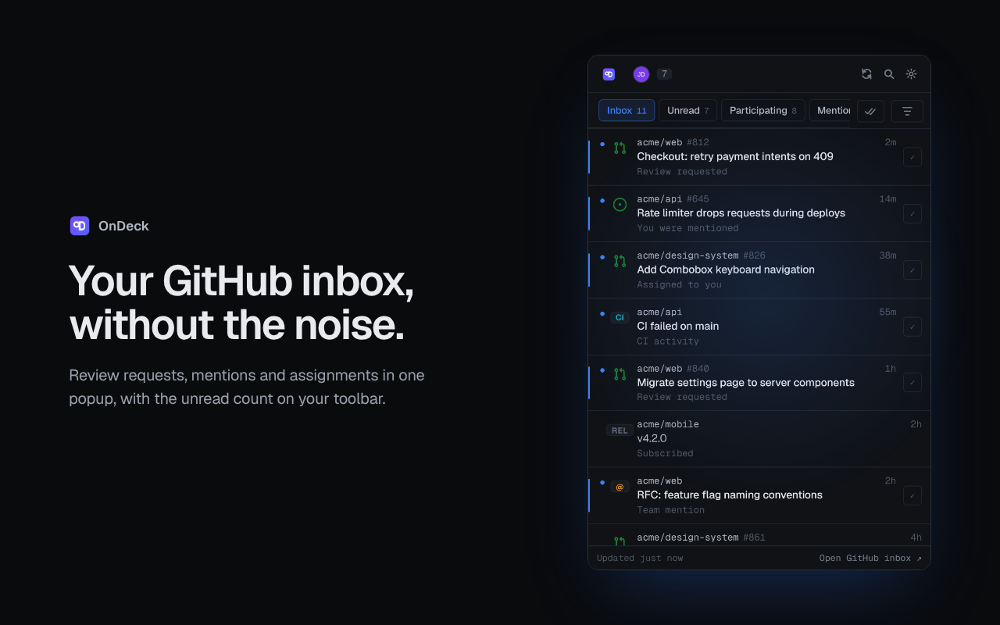

# OnDeck

A Chrome extension that turns your GitHub notifications into a calm inbox in
the toolbar: review requests, mentions and assignments up front, the unread
count on the icon, and a desktop alert when something needs you.



The landing page lives at [OnDeck/ondeck-site](https://github.com/OnDeck/ondeck-site).

## What it does

- **Inbox** of your GitHub notifications, newest first, with chips for
  Unread, Participating, Mentions, Reviews and Assigned, plus repository and
  date filters and ⌘K search.
- **Threads that need you** (review requests, mentions, assignments, security
  alerts) get an accent bar so they stand out from watcher noise.
- **Mark as read** per thread, or everything you're looking at in one go.
- **Toolbar badge** with your unread count, kept current by a background sync
  (every 5–60 minutes, your choice).
- **Desktop notifications** for new activity, filtered to the reasons you pick.
  Clicking one opens the PR or issue.
- **Instant open**: the popup renders the last synced inbox immediately and
  refreshes in place.

OnDeck only talks to GitHub. Your token stays in your browser and is only ever
sent to `api.github.com`; sign-in itself goes through `github.com/login`.
There's no OnDeck server.

## Getting started

### Prerequisites

- Node.js 20 LTS and npm
- Chrome or another Chromium browser with Manifest V3 support (Edge, Brave, Arc)
- A GitHub account

### Build and load

```bash
git clone https://github.com/OnDeck/ondeck-extension.git
cd ondeck-extension
npm install
npm run build        # one-shot production build → dist/
# or: npm run dev    # rebuilds dist/ on every save
```

1. Open `chrome://extensions` and turn on **Developer mode**.
2. Click **Load unpacked** and pick the `dist/` folder (not the repo root or
   `public/`).
3. Pin OnDeck to the toolbar. Open it with the icon or ⌘⇧L / Ctrl+Shift+L.

The popup is a bundled React app loaded from `dist/`, not a dev server. After
a rebuild, click the refresh icon on the extension's card in
`chrome://extensions`.

### Sign in

**Sign in with GitHub** (builds with `VITE_GITHUB_CLIENT_ID` set): click the
button, then **Copy code and open GitHub** and enter the one-time code. The
popup can close while you do this. The service worker keeps polling and
signs you in once you approve.

**Personal access token** (always available):

1. Click **Create token on GitHub** in the popup. It opens GitHub's
   classic-token page with the `notifications` and `repo` scopes selected.
   Fine-grained tokens can't call the notifications API yet.
2. Generate the token, paste it into the popup and press Enter.

Either way the token is checked against `/user`, encrypted with AES-GCM and
stored in `chrome.storage.local`. Sign out from **Settings**. That removes the
token, the cached inbox and the local key. An OAuth token stays authorised on
GitHub until you revoke it under
[Settings → Applications](https://github.com/settings/applications).

#### Enabling Sign in with GitHub

1. Register an OAuth app under your account or org settings → Developer
   settings → OAuth Apps. Any homepage and callback URL will do; the device
   flow doesn't use the callback.
2. Tick **Enable Device Flow**.
3. Copy the client ID (it's public, not a secret) into `.env.local`:

   ```bash
   VITE_GITHUB_CLIENT_ID=Ov23li...
   ```

4. Rebuild. Without the variable the popup shows only the token sign-in.

### Troubleshooting

- **"GitHub token expired"**: the token was revoked or expired. Click
  **Reconnect** and paste a new one.
- **"Missing permissions"**: the token lacks the `notifications` scope, or it's
  a fine-grained token. Create a classic token from the sign-in screen.
- **"Rate limited by GitHub"**: wait for the time shown, or raise the sync
  interval in Settings.
- **"Manifest file is missing or unreadable"**: you loaded the wrong folder.
  Pick `dist/`.

## Development

```bash
npm run dev          # watch build → dist/
npm run build        # tsc -b + production build
npm run lint         # ESLint
npm run typecheck    # tsc --noEmit
npm test             # Vitest unit tests
npm run test:e2e     # Playwright (needs a Chromium download)
```

CI runs lint, typecheck, tests and the build on every push. PR titles must
follow Conventional Commits. Releases are cut manually from the **Release**
workflow, which bumps the version in `package.json` and the manifest and
updates `CHANGELOG.md` (see [docs/RELEASE_PROCESS.md](docs/RELEASE_PROCESS.md)).

### Layout

```
src/
├── background/              # MV3 service worker
│   ├── service-worker.ts    # install/startup hooks, message + storage listeners
│   ├── schedulers/alarm.ts  # periodic sync alarm
│   └── workers/             # sync (incremental fetch, badge) + desktop notifications
├── lib/                     # GitHub REST client, auth, AES-GCM token storage, settings
├── shared/                  # Code used by both the worker and the popup
│   └── notifications/       # cache, merge, mark-read planning, grouping
└── popup/                   # React popup: components/, hooks/, main.tsx
```

The popup and the worker both depend on `lib/` and `shared/`, never on each
other. They communicate through `chrome.storage` and runtime messages
(`REQUEST_SYNC`, `NEW_NOTIFICATIONS`).

## Chrome Web Store

Listing copy, permission justifications, privacy-practice answers and store
images are in [docs/store](docs/store/LISTING.md).

## License

[MIT](LICENSE)
